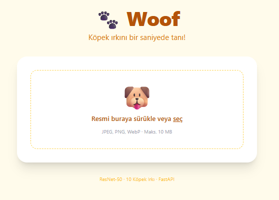
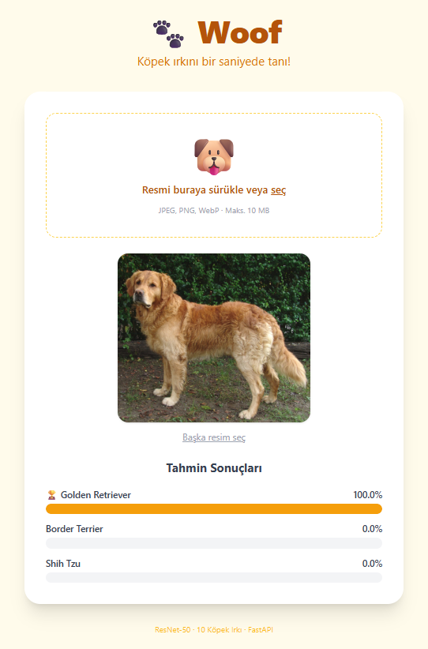

# 🐾 Woof — Dog Breed Classifier

Upload a dog photo and get the predicted breed in a second. Woof uses a fine-tuned **ResNet50** (PyTorch) served by a **FastAPI** backend with a simple drag-and-drop web interface.

<p align="center">
  
  
</p>

## Features

- Transfer learning: ImageNet-pretrained ResNet50 with a new 10-class head
- Top-3 predictions with confidence scores
- REST API (`POST /predict`) returning JSON
- Input validation: JPEG / PNG / WebP / GIF, max 10 MB
- Drag-and-drop web UI with live preview

## Supported breeds

Australian Terrier, Beagle, Border Terrier, Dingo, English Foxhound, Golden Retriever, Old English Sheepdog, Rhodesian Ridgeback, Samoyed, Shih Tzu

## Quick start

```bash
git clone https://github.com/BySweK/dog-breed-classifier-fastapi.git
cd dog-breed-classifier-fastapi

python -m venv .venv
source .venv/bin/activate        # Windows: .venv\Scripts\activate
pip install -r requirements.txt
```

Download the trained weights into the project folder:

```bash
curl -L -o resnet50_model.pth https://github.com/BySweK/dog-breed-classifier-fastapi/releases/download/v1.0.0/resnet50_model.pth
```

Run the app:

```bash
uvicorn main:app --reload
```

Then open http://127.0.0.1:8000

## API

```bash
curl -X POST http://127.0.0.1:8000/predict -F "file=@my_dog.jpg"
```

Response:

```json
{
  "predictions": [
    { "label": "Beagle", "confidence": 94.21 },
    { "label": "English Foxhound", "confidence": 4.37 },
    { "label": "Border Terrier", "confidence": 0.82 }
  ]
}
```

Interactive API docs: `/docs`

## Project structure

```
├── main.py            FastAPI app
├── model.py           Model loading and inference
├── classes.py         Breed names
├── requirements.txt
└── templates/
    └── index.html     Web UI
```

## Notes

- The model only knows the 10 breeds above; any other image will still be assigned to one of them.
- CORS is open for local development; restrict it in production.

## Tech stack

PyTorch, Torchvision, FastAPI, Uvicorn, Pillow, HTML / Tailwind CSS / JavaScript. The web interface was built with the help of Cursor AI.
